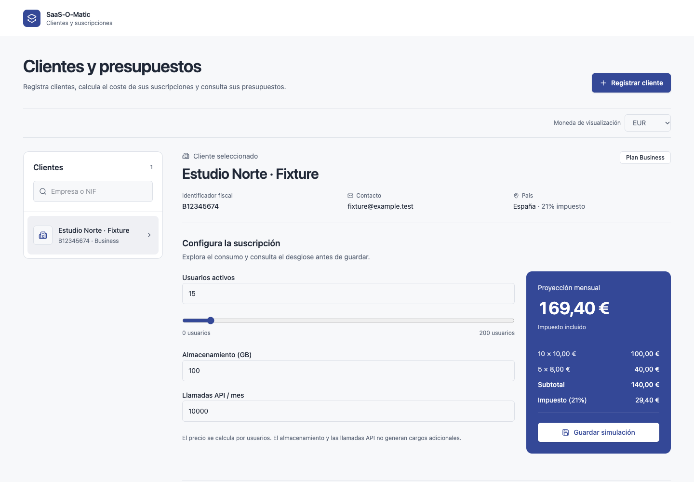
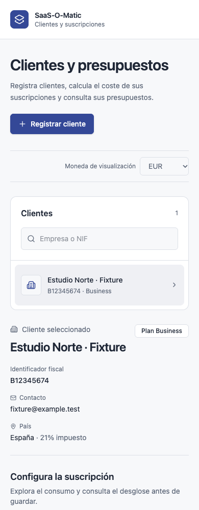
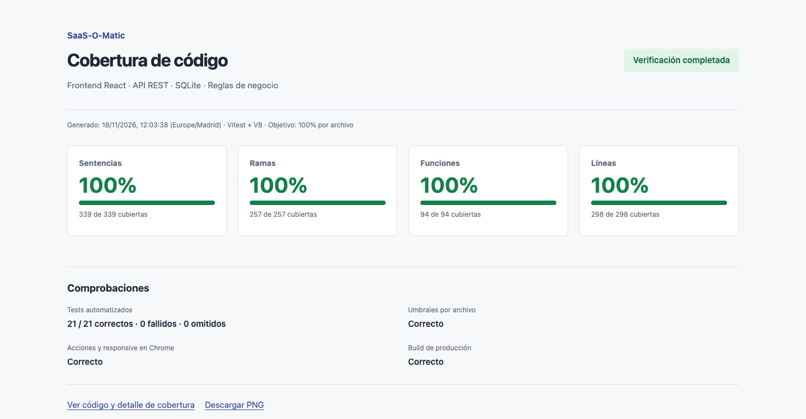

# SaaS-O-Matic

Customer management and usage-based subscription quoting with a React frontend, a Node.js REST API, and SQLite persistence.

Register corporate customers, calculate monthly costs with progressive pricing, and review saved estimates in EUR, USD, or GBP.

[Quick start](#quick-start) · [Screenshots](#screenshots) · [Architecture](#architecture) · [API](#api) · [Testing](#testing-and-coverage) · [AI workflow](#ai-workflow-and-project-skills)

## Stack

| Layer        | Implementation                                           |
| ------------ | -------------------------------------------------------- |
| Frontend     | React 19, JavaScript ES modules, Vite 6                  |
| UI           | Tailwind CSS 4, shadcn/ui, locally maintained components |
| Backend      | Node.js HTTP server and REST endpoints                   |
| Persistence  | SQLite through the built-in `node:sqlite` module         |
| Verification | Vitest, V8 coverage, React Testing Library, Playwright   |

## Quick start

**Requirements:** Node.js 22.14 or newer and npm. Browser tests additionally require Chrome or Playwright Chromium.

```sh
git clone https://github.com/diegogomezgonza/SaaS-O-Matic.git
cd SaaS-O-Matic/saas-o-matic
npm ci
npm run dev
```

Open [http://127.0.0.1:5173](http://127.0.0.1:5173). The command starts Vite and the API together; `Ctrl+C` stops both.

| Service         | Address                                                |
| --------------- | ------------------------------------------------------ |
| Application     | `http://127.0.0.1:5173`                                |
| REST API        | `http://127.0.0.1:3000`                                |
| Coverage viewer | `http://127.0.0.1:4174` after `npm run coverage:serve` |

SQLite initializes automatically. No database service or API key is required. Internet access is only needed for exchange rates; EUR calculations remain available if the provider cannot be reached. Node.js 22 emits an experimental warning for its built-in SQLite API.

## Screenshots

Screenshots use isolated synthetic customer data. Click an image to open its full-page version.

### Desktop dashboard

[](ai-workspace/evidencias/escritorio.png)

### Mobile dashboard

<a href="ai-workspace/evidencias/movil.png"></a>

### Coverage report

[](saas-o-matic/coverage-report/coverage.png)

The [full HTML artifact](saas-o-matic/coverage-report/index.html) includes per-file source coverage. Run `npm run coverage:serve` from the application directory to browse it interactively.

## Architecture

```text
.
├── saas-o-matic/
│   ├── src/              React application, feature modules, UI, hooks, HTTP services
│   ├── server/           REST routing, validation, SQLite repository, exchange rates
│   ├── shared/           Pricing rules and commercial catalog
│   ├── config/           Shared development, preview, and E2E proxy configuration
│   ├── tests/            Domain, API, security, component, and hook tests
│   ├── scripts/          Development, browser checks, and report tooling
│   └── coverage-report/  Generated HTML, source details, and PNG
├── ai-workspace/          Specifications, architecture, prompts, skills, and evidence
└── AGENTS.md              Repository-level development instructions
```

The UI is organized around customer and simulation features. Services isolate network access; reusable UI components contain no persistence or pricing rules. The backend validates requests and owns persisted prices. A shared pure function provides the same pricing calculation for the interactive preview.

See the [architecture and database model](ai-workspace/arquitectura.md) and the [application file inventory](ai-workspace/inventario-archivos.md) for implementation details.

## API

Routes have **no `/api` prefix**. Write requests require `Content-Type: application/json`.

| Method | Endpoint                     | Purpose                                        |
| ------ | ---------------------------- | ---------------------------------------------- |
| `GET`  | `/health`                    | Check API availability                         |
| `GET`  | `/catalog`                   | Read supported countries, tax rates, and plans |
| `GET`  | `/customers?q=`              | Search by company name or tax identifier       |
| `POST` | `/customers`                 | Register a corporate customer                  |
| `GET`  | `/customers/:id`             | Read customer details                          |
| `GET`  | `/customers/:id/simulations` | Read saved estimates                           |
| `POST` | `/simulations`               | Calculate and persist an estimate              |
| `GET`  | `/exchange-rates`            | Read validated EUR-based currency rates        |

Customer fields: `companyName`, `taxId`, `email`, `country`, `plan`. Simulation fields: `customerId`, `users`, `storageGb`, `apiCalls`.

Responses use `201` for creation, `422` for validation errors, `409` for duplicate customers, and `404` for missing resources. Errors follow `{ message, fields? }`. Supplied price fields are rejected; the API calculates totals. Customer searches return up to 100 matches.

Examples, validation limits, and configuration are documented in the [runtime reference](saas-o-matic/README.md).

## Pricing model

| User range     | Unit price         |
| -------------- | ------------------ |
| First 10 users | EUR 10.00 per user |
| Users 11–50    | EUR 8.00 per user  |
| Users above 50 | EUR 5.00 per user  |

Pricing is cumulative: 15 users cost `10 × 10 + 5 × 8 = EUR 140.00` before tax. With the configured ES rate of 21%, the total is `EUR 169.40`.

Amounts are calculated in integer cents. Tax is rounded once, and each saved estimate retains its original EUR breakdown. Changing the display currency does not modify stored values.

Supported tax profiles are ES 21%, FR 20%, DE 19%, PT 23%, and GB 20%. Exemptions, reverse-charge rules, and customer-specific tax treatment are not implemented. Plans, storage, and API calls are recorded without additional charges. Spanish tax identifiers are validated by format and checksum; this does not verify registration with the tax authority.

## Testing and coverage

Run all commands below from `saas-o-matic/`.

```sh
npm test                 # Domain, API, security, hooks, and components
npm run test:e2e         # Integrated browser flows and responsive checks
npm run test:coverage    # Coverage thresholds + E2E + build + HTML/PNG generation
npm run coverage:serve   # Browse the report on port 4174
npm run coverage:png     # Export the latest HTML report again
```

For browser tests, install Chromium if Chrome is unavailable:

```sh
npx playwright install chromium
```

`CHROME_PATH` can point to a custom browser executable. E2E uses an in-memory SQLite database and fixture exchange rates, without modifying application data. It checks customer registration, search, validation errors, pricing, saving, history, currencies, retries, and layouts at 320, 390, 768, and 1440 pixels.

The recorded report contains **21 passing tests** and **100% lines, statements, functions, and branches per functional source file**. Thresholds are enforced in `vitest.config.js`. Only the two bootstrap files, `src/main.jsx` and `server/index.js`, are excluded from the functional coverage percentage. Configuration, styles, tools, tests, and dependencies are outside that measurement. Coverage is execution evidence, not a security certification.

## Development and configuration

```sh
npm run dev:client       # Vite only
npm run dev:server       # API with file watching
npm run format          # Format application files
npm run format:check    # Check formatting
npm run components:add -- button
```

The API defaults to port `3000` and stores data in `saas-o-matic/data/client-register.sqlite`. `DATABASE_PATH` and `PORT` configure the server. When changing the API port, update the Vite proxy target as well. `CHROME_PATH` applies to browser checks and PNG export. See the [runtime reference](saas-o-matic/README.md#configuration) for the full configuration table and build-preview commands.

## AI workflow and project skills

Versioned project skills define the constraints used during implementation and review:

| Skill                      | Responsibilities                                                                                                 | Files                                                                                                                                                                                |
| -------------------------- | ---------------------------------------------------------------------------------------------------------------- | ------------------------------------------------------------------------------------------------------------------------------------------------------------------------------------ |
| Code quality and security  | Feature boundaries, validation, data protection, safe errors, maintainability, and verification                  | [SKILL.md](ai-workspace/skills/client-register-code-quality-security/SKILL.md) · [Agent configuration](ai-workspace/skills/client-register-code-quality-security/agents/openai.yaml) |
| UI design and product copy | Tailwind/shadcn conventions, responsive layouts, accessibility, reusable controls, and functional interface text | [SKILL.md](ai-workspace/skills/client-register-ui-design/SKILL.md) · [Agent configuration](ai-workspace/skills/client-register-ui-design/agents/openai.yaml)                         |

[AGENTS.md](AGENTS.md) routes development work to these skills. Their original `client-register-*` identifiers remain stable; both are scoped to SaaS-O-Matic.

The [AI workspace index](ai-workspace/README.md) links to the [development plan](ai-workspace/planificacion.md), [specification](ai-workspace/especificacion.md), [selected prompts](ai-workspace/prompts.md), [iteration notes](ai-workspace/iteraciones.md), and [process log](saas-o-matic/proceso-prueba.md).

## Security and operational boundaries

The API binds to loopback. Authentication and per-user authorization are not implemented; external hosting requires those controls and HTTPS. Requests use field allowlists, numeric limits, a 16 KB body limit, host/origin checks, and rate limiting. SQLite access uses parameterized queries and foreign keys.

Customer records are not written to browser storage, included in logs, or sent to the exchange-rate provider. Database files, environment files, dependencies, build outputs, and intermediate test artifacts are excluded from Git.

Known dependency advisories, validation evidence, and remaining operational limits are recorded in the [verification notes](ai-workspace/verificacion.md).
