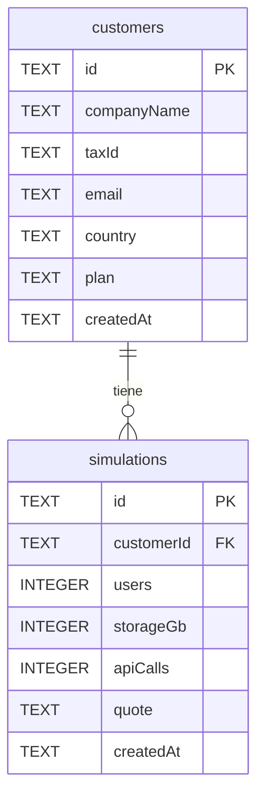

# Arquitectura de SaaS-O-Matic

La aplicación usa React/JavaScript y Vite para la interfaz, una API REST en Node.js y SQLite para persistir clientes y simulaciones. Este documento describe la organización entregada y las decisiones que guían su mantenimiento.

## Límites y flujo

```text
Pantallas y componentes React
    → hooks y servicios de cada feature
    → cliente HTTP compartido
    → rutas REST
    → validación de entrada y reglas de negocio
    → repositorio SQLite

Proveedor de cambio HTTPS ← servicio del backend con validación y caché
```

El frontend utiliza las rutas del backend mediante un proxy de Vite limitado a esas familias; en desarrollo y preview puede seguir sirviendo sus propios módulos y assets. `config/api-proxy.js` es compartido con E2E para evitar configuraciones divergentes. Los contratos concretos están en [especificacion.md](especificacion.md).

## Organización del código

| Ubicación en `saas-o-matic/` | Responsabilidad |
| --- | --- |
| `src/app` y `src/main.jsx` | Composición y entrada de React |
| `src/features/customers` | Alta, búsqueda, selección, detalle, hook y servicio de clientes |
| `src/features/simulations` | Formulario de consumo, desglose, histórico y servicio de guardado |
| `src/components/layout` y `src/components/ui` | Estructura de pantalla y controles reutilizables sin reglas de negocio |
| `src/shared` y `src/lib` | HTTP, cambios de divisa, formatos y composición de clases |
| `src/styles/globals.css` | Tokens semánticos, estilos globales y adaptación accesible |
| `shared` | Catálogo comercial y cálculo puro compartido de precios |
| `server/app.js` | Rutas, límites HTTP, origen/host y errores seguros |
| `server/validation.js` y `server/domain` | Campos permitidos, rangos y algoritmo de control fiscal |
| `server/database.js` | Única frontera de persistencia SQLite |
| `server/exchange-rates.js` | Única integración con el proveedor externo |
| `config`, `tests` y `scripts` | Configuración de proxy, verificación y herramientas reproducibles |

## Modelo de datos



`customers` tiene unicidad en `(country, taxId)`. `simulations.customerId` referencia el cliente y tiene un índice con fecha para consultar el histórico. Se activan claves foráneas y WAL. Las consultas están parametrizadas; el archivo de datos está excluido de Git.

`quote` conserva un JSON con el desglose: usuarios por tramo, precio unitario, base, porcentaje de impuesto, impuesto y total en céntimos. Se calcula en servidor al guardar, sin aceptar importes suministrados por el navegador. La interfaz usa la misma función pura para previsualizar. Los tipos de cambio no modifican el presupuesto guardado.

El archivo `data/client-register.sqlite` conserva su nombre técnico anterior al cambio de marca para mantener los datos existentes. El nombre del producto y del paquete es SaaS-O-Matic / `saas-o-matic`.

## Directrices dadas a la IA

Las instrucciones se fijaron en [AGENTS.md](../AGENTS.md) y dos skills versionables:

- [Calidad y seguridad](skills/client-register-code-quality-security/SKILL.md): límites por feature, lógica fuera de JSX, comentarios sobre decisiones no obvias, validación de servidor, protección de datos y verificación antes de entregar.
- [Diseño y redacción](skills/client-register-ui-design/SKILL.md): tokens Tailwind y componentes locales shadcn/ui, comportamiento responsive, foco y estados claros, textos funcionales de producto.

Estas reglas evitan concentrar rutas, SQL y componentes en un mismo archivo o generar implementaciones duplicadas. Los servicios de frontend encapsulan I/O y los componentes reutilizables no conocen el dominio. Se mantienen los identificadores originales de las skills para preservar sus invocaciones.

## Límites de seguridad

Hay validación por lista de campos, límites de tamaño y frecuencia, control de host/origen, consultas parametrizadas y errores sin información interna. No hay credenciales en el frontend, PII en logs ni datos de clientes enviados al proveedor de cambios. La aplicación requiere autenticación, permisos y HTTPS antes de exponerse públicamente; esos límites y los avisos de dependencias están documentados en [verificacion.md](verificacion.md).
